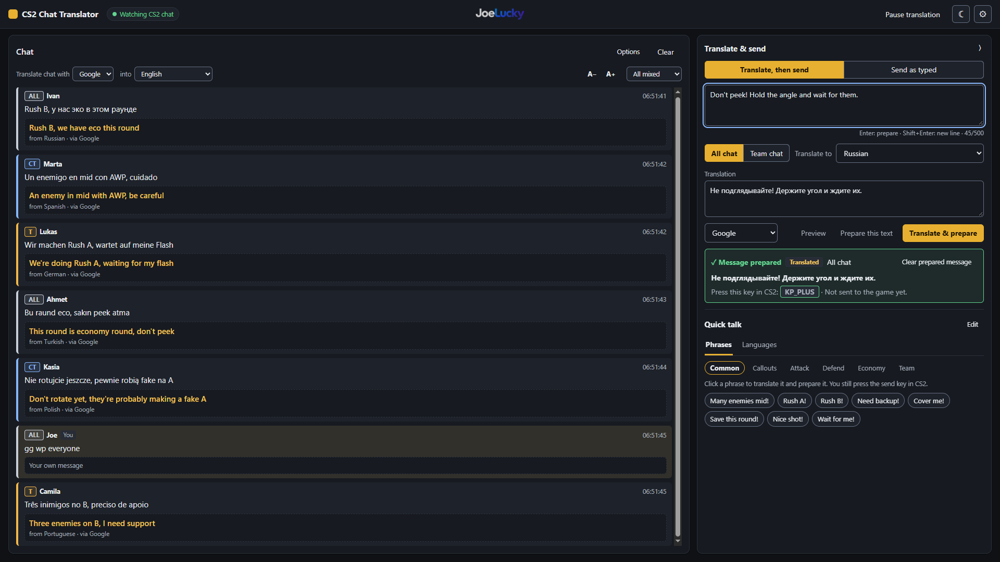
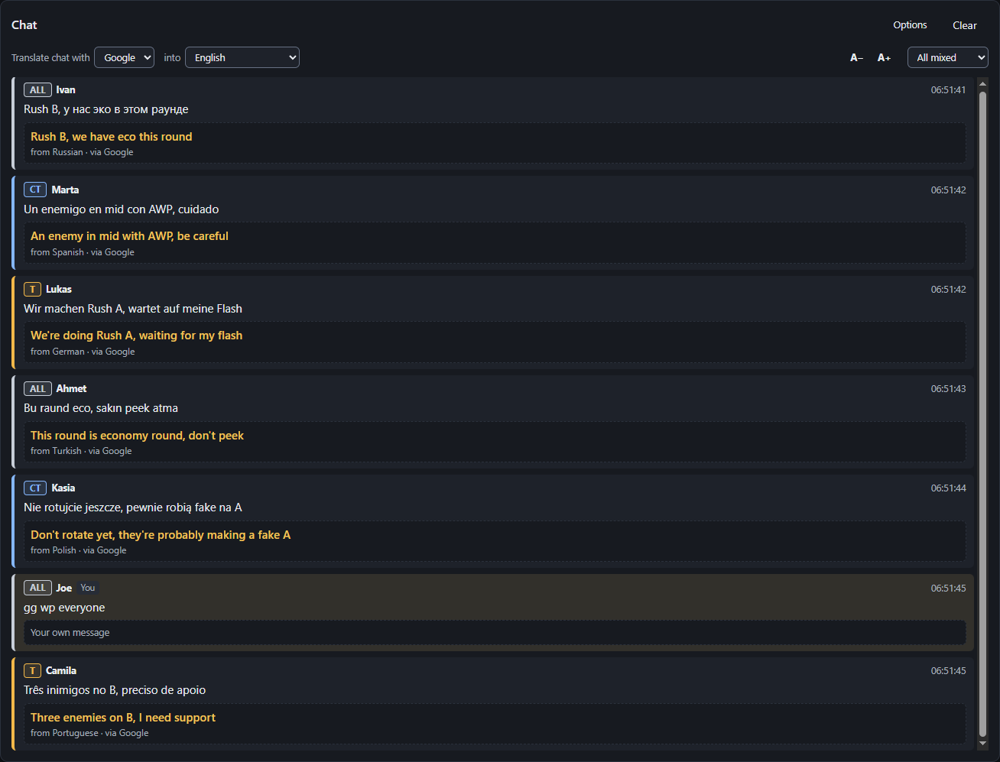
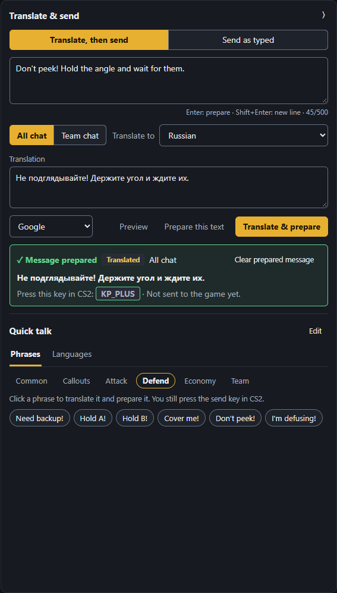
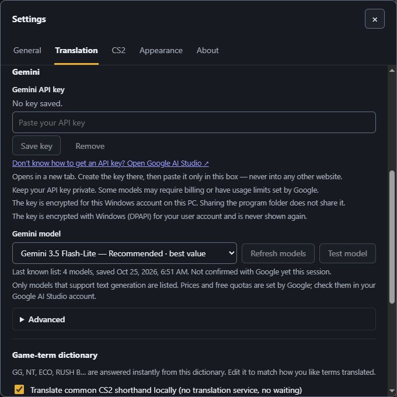
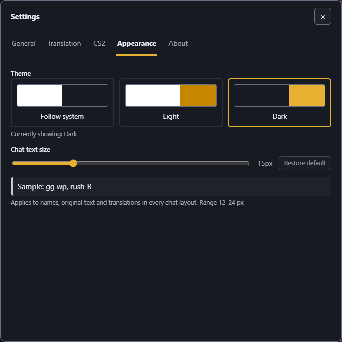

<p align="center"></p>

# CS2 Chat Translator

**English** | [繁體中文](README.zh-TW.md)

**A real-time chat translator for Counter-Strike 2** — free, for Windows, by Joe (JoeJoe1024).

CS2 Chat Translator reads the chat CS2 writes to its own log, shows every message with a translation next to the original, and lets you answer in the other player's language. It is made for players who often meet teammates and opponents who do not share their language.



<sub>Screenshot of the running app with invented demo players and messages.</sub>

## Features

**Live chat translation**
- Watches the CS2 chat log and translates team and all chat as it arrives.
- Always shows the original text first, then the translation, with the source language and the engine used.
- Google Translate (no key) or Gemini (your own API key) — chosen separately for incoming chat and for sending.
- Common CS2 shorthand (GG, NT, ECO, RUSH B …) is answered instantly by a built-in dictionary you can edit.

**Translate & send**
- Type a message, translate it, and prepare it for CS2 — or prepare your text exactly as typed, with no translation at all.
- Send to all chat or team chat. **Enter** prepares, **Shift+Enter** starts a new line.
- The prepared message is written to a small cfg file; **you** then press your own key in CS2 to send it. The app never presses keys for you and never talks to the game directly.

**Quick talk**
- 24 ready-made CS2 phrases in categories: common, callouts, attack, defend, economy, team.
- Add, edit, delete and re-order your own phrases; clicking one translates it and prepares it.
- Favourite languages: one click changes the language you send in.

**Chat views**
- All mixed, team only, all chat only, or split view (team left, all chat right).
- New messages scroll into view automatically; scroll up and it stops following until you return to the bottom or press "Back to latest".

**Your layout**
- Drag the divider between the two panels (70 / 30 by default) or collapse the right panel entirely.
- Chat text size, light / dark / follow-system theme. Everything is remembered.

**Languages**
- 13 interface languages; the first start follows your system language, and your own choice always wins.
- The interface language and the languages you translate to are independent.

## Why I Built This

I'm a passionate Counter-Strike 2 player. While playing, I often meet teammates and opponents from around the world, but language barriers can sometimes make communication difficult.

That's why I decided to create CS2 Chat Translator — a simple, practical, and easy-to-use tool that helps players understand each other and communicate across different languages.

The application offers real-time chat translation, multiple translation engines, quick phrases, multilingual support, and an intuitive interface, allowing players to focus more on the game.

CS2 Chat Translator is a free personal project. The source code is publicly available to read and learn from, while unauthorised commercial use is not allowed (see [License](#license-and-third-party-notices)).

I continue improving this project in my spare time, and I hope it helps more players overcome language barriers and enjoy the game.

— Joe (JoeJoe1024)

## Download and install

> **Latest release: [v1.0.0](https://github.com/JoeJoe1024/cs2-chat-translator/releases/tag/v1.0.0)** on this repository's GitHub **Releases** page. It offers the Windows Portable ZIP (with its `.sha256.txt` checksum file) and, as GitHub's automatic "Source code" archives, the full source code.

There are two ways to get CS2 Chat Translator. **Most players want the Windows Portable build.**

| | **Windows Portable** (recommended for players) | **Source code** (for reviewing, modifying or building yourself) |
|---|---|---|
| What it is | A ready-to-run ZIP: `start.bat`, the built app and a bundled Node.js runtime | The full source code of the same v1.0.0 (GitHub's automatic "Source code" ZIP of the release, or `git clone`) |
| Needs Node.js installed? | **No** | **Yes — Node.js 22.12 or newer** and npm, which you install yourself |
| Needs a build step? | No | Yes: `npm install`, then `npm run build` |
| Size | about 33 MB ZIP (most of it is the Node.js runtime) | a few MB, plus about 170 MB of dependencies after `npm install` |
| Features | Identical — both are built from the same source code | Identical |

Do not expect the source code to run without setup: `start.bat` in the source download needs Node.js and the build output, and it will tell you if either is missing.

### Windows Portable (no Node.js needed)

1. Download [`cs2-chat-translator-v1.0.0-windows-portable.zip`](https://github.com/JoeJoe1024/cs2-chat-translator/releases/download/v1.0.0/cs2-chat-translator-v1.0.0-windows-portable.zip) from GitHub Releases.
2. *(Optional)* Verify the download: the release page lists a SHA-256 hash. In PowerShell run `Get-FileHash .\cs2-chat-translator-v1.0.0-windows-portable.zip -Algorithm SHA256` and compare the result with the published value.
3. Unzip it anywhere you like (do not run it from inside the ZIP).
4. Double-click `start.bat`. Your browser opens the app (a second double-click only opens the page again).
5. Follow "Quick start" below.

The Portable build is not code-signed, so Windows SmartScreen may show a warning the first time. Your settings and encrypted API key are stored in `%APPDATA%\cs2-chat-translator`, not in the unzipped folder.

### Source code (build it yourself)

Requirements: Windows, [Node.js](https://nodejs.org/) 22.12 or newer (LTS is fine), and an internet connection for `npm install`.

```bash
npm install
npm run build
```

Then double-click `start.bat` (or run `node dist/launcher.mjs`). `npm run check` runs the type check, lint, tests and the build. The license allows you to read, modify and share the code for noncommercial purposes; see [License](#license-and-third-party-notices). See [docs/ARCHITECTURE.md](docs/ARCHITECTURE.md) for the design. To report a vulnerability, see [SECURITY.md](SECURITY.md).

## Quick start

1. **Start CS2 Chat Translator** with `start.bat`.
2. **Prepare CS2 once** (Settings → CS2 → First-time setup, every command has a Copy button):
   - Steam launch option: `-condebug`, so CS2 writes `console.log`.
   - In the CS2 console, paste the bind command, for example `bind "kp_plus" "exec chat_reader.cfg"`.
3. **Check the status** in the top-left: "Watching CS2 chat" means the log is being read.
4. **Incoming chat** — pick the engine and the language you want to read in (toolbar above the chat).
5. **Your message** — pick the language to send in, type on the right (or click a quick phrase), press **Enter**.
6. **In CS2**, press the key you bound. That is the only moment anything is sent.

Three separate things happen, and it helps to keep them apart: *incoming chat* is translated automatically for you to read; *your message* is translated and **prepared** when you press Enter; the game **sends** it only when you press your key.

## The interface in detail

### Live chat and translations



Each message shows its channel (ALL / CT / T), the player, the original text and the translation. Your own messages can be left untranslated or hidden (Options). The toolbar changes the engine, the target language, the layout and the text size.

### Translate & send, and Quick talk



The green card shows exactly what is prepared, which channel it goes to and which key sends it — and that it is **not sent yet**. If a translation fails, the previously prepared message is withdrawn so your key cannot send something you did not intend. Quick phrases work the same way: one click translates and prepares.

### Gemini and the model list



The model list comes from Google itself and is filtered to stable, low-cost Flash and Flash-Lite text models. The sample above shows the list from the last successful refresh.

### Appearance



Light, dark or follow the system, plus the chat text size (12–24 px). The interface language is under Settings → General.

## Supported interface languages

繁體中文 · English · Русский · 简体中文 · Português (Brasil) · Español · Polski · Türkçe · Deutsch · Français · 日本語 · 한국어 · Tiếng Việt

On the first start the app picks the first of these that matches your system's language preferences (Traditional Chinese regions get 繁體中文, other Chinese gets 简体中文, any Portuguese gets Português (Brasil); otherwise English). Choose a language under Settings → General at any time; a manual choice is never overridden, and "Automatic" brings back the system behaviour.

This list is only the interface. The languages you can **translate** to and from depend on the engine you select.

## Gemini API key

Google Translate needs no key but is an unofficial web endpoint: it may be rate-limited or stop working at any time. Gemini is Google's official AI service and needs your own API key, which usually gives more natural translations of gaming slang.

1. Open [Google AI Studio](https://aistudio.google.com/app/apikey) (the link is also in Settings → Translation) and create an API key.
2. In Settings → Translation, paste it only into the Gemini key box and press **Save key**. It is encrypted with Windows (DPAPI) for your user account and is never shown again.
3. Press **Refresh models**, choose a model (the recommended one is `gemini-3.5-flash-lite`), then **Test model**. The test uses the model currently selected.

Keep your key private; never paste it into any other website. Some models may require billing or have usage limits set by Google — not every Gemini model is free, so check your Google AI Studio account. Nothing is sent to Gemini unless you select it as an engine.

## FAQ

**Why is no CS2 chat shown?**
Start CS2 with the launch option `-condebug`, make sure the status says "Watching CS2 chat", and check the log path under Settings → CS2. The log only contains chat after CS2 has started.

**Is translating free?**
Google Translate is free to use. Gemini needs your own API key and may cost money depending on the model and your Google account.

**Do I need a Gemini key?**
No. Google Translate works without one; Gemini is optional.

**The message is prepared, but nothing was sent.**
Preparing only writes the cfg file. Press the key you bound (shown on the green card) inside CS2, after running the bind command once.

**Why is a translation wrong?**
Machine translation of fast gaming slang is never perfect. Try the other engine or a different Gemini model, and edit the translation before preparing it; the built-in dictionary covers common CS2 terms.

**Can I use my own key?**
Yes: Settings → CS2 → Send key → Change key, then press the key you want and run the new bind command in CS2.

**Can I change the interface language?**
Yes, Settings → General. 13 languages are available.

**Does it send chat automatically?**
No. It never sends anything to the game on its own and never simulates key presses; you always press your own key.

**Is this affiliated with Valve?**
No. Counter-Strike is a trademark of Valve Corporation. The app only reads the log CS2 writes and writes one cfg file.

## License and third-party notices

CS2 Chat Translator is licensed under the **[PolyForm Noncommercial License 1.0.0](LICENSE)**. It is *source-available*, not an OSI-approved open-source license (it is not MIT or GPL).

- **Free for players.** You may use, modify and share it for any noncommercial purpose, as the license text describes.
- **No unauthorised commercial use.** You may not sell, rent or repackage the software itself, or build it into a commercial product or paid service, without my written permission.
- **Streamers may use it free of charge**, even when their streams earn money from ads, subscriptions, donations or platform revenue sharing. This is a separate extra permission written in [STREAMING_PERMISSION.md](STREAMING_PERMISSION.md); it does not change the PolyForm terms.
- **Commercial licensing:** write to [support@joelucky.io](mailto:support@joelucky.io).

Third-party components keep their own licenses; see [THIRD-PARTY-NOTICES.txt](THIRD-PARTY-NOTICES.txt). The JoeLucky name and logo are not covered by this license. "Counter-Strike" is a trademark of Valve Corporation, and this project is not affiliated with Valve. The chat formats are read at run time from your own CS2 installation; no game files are distributed.

## Developer, support and links

**Developer:** Joe (JoeJoe1024)

- Bug reports and feature requests: [GitHub Issues](https://github.com/JoeJoe1024/cs2-chat-translator/issues)
- General questions, technical help, collaboration and commercial licensing: [support@joelucky.io](mailto:support@joelucky.io)
- Security vulnerabilities: please report them privately by email, not in a public issue (see [SECURITY.md](SECURITY.md))
- GitHub: <https://github.com/JoeJoe1024/cs2-chat-translator>
- My other project: [JoeLucky](https://joelucky.io)

If CS2 Chat Translator has been helpful, I'd really appreciate a ⭐ Star on GitHub! Your support motivates me to keep improving the app.
