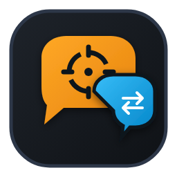
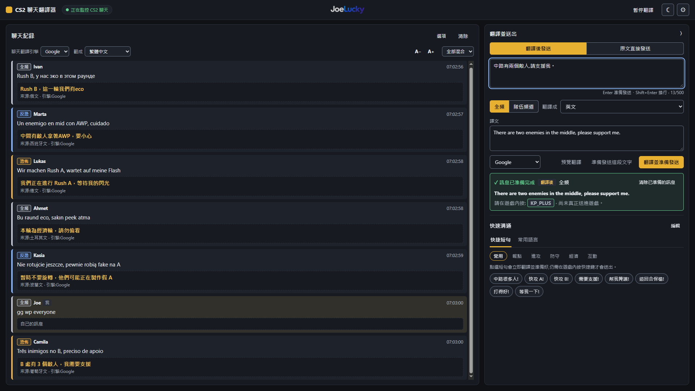
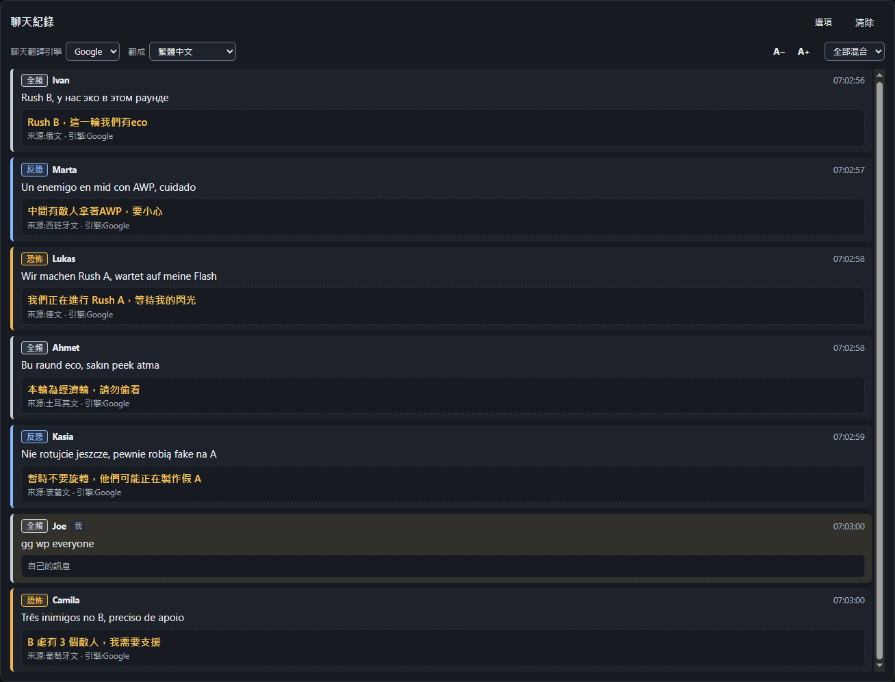
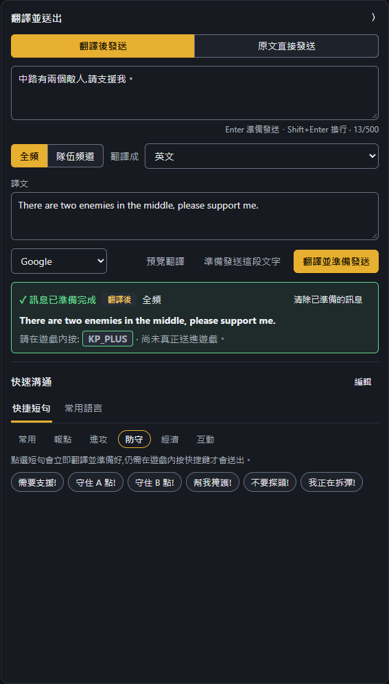
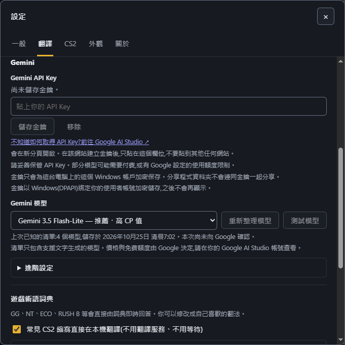
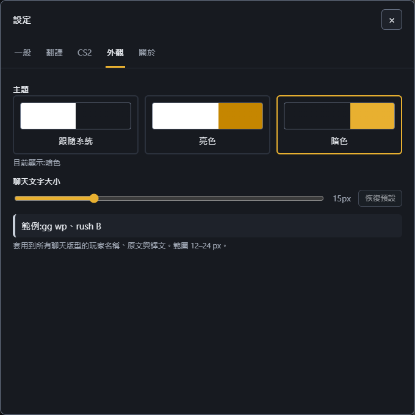

<p align="center"></p>

# CS2 Chat Translator

[English](README.md) | **繁體中文**

**Counter-Strike 2 即時聊天翻譯工具** —— 免費、Windows 平台,開發者:Joe(JoeJoe1024)。

CS2 Chat Translator 會讀取 CS2 自己寫出的聊天紀錄,把每一則訊息連同譯文一起顯示,也能讓你用對方的語言回話。適合常遇到不同語言的隊友與對手的 CS2 玩家。



<sub>實際執行中的程式截圖,玩家與訊息皆為虛構的示範資料。</sub>

## 主要功能

**即時聊天翻譯**
- 監控 CS2 聊天紀錄,隊伍與全頻聊天一收到就翻譯。
- 一律先顯示原文,再顯示譯文,並標示來源語言與使用的引擎。
- Google 翻譯(免金鑰)或 Gemini(使用你自己的 API Key),接收與發送可分別選擇。
- 常見 CS2 縮寫(GG、NT、ECO、RUSH B…)由內建詞典即時回答,詞典可自行編輯。

**翻譯並送出**
- 輸入訊息、翻譯、準備好交給 CS2;也可以「原文直接發送」,完全不經過翻譯。
- 可選全頻或隊伍頻道。**Enter** 準備發送,**Shift+Enter** 換行。
- 準備好的訊息會寫進一個小小的 cfg 檔,**由你自己**在 CS2 裡按下綁定的按鍵才會送出。程式不會替你按鍵,也不會直接操控遊戲。

**快速溝通**
- 24 句預設 CS2 短句,分成:常用、報點、進攻、防守、經濟、互動。
- 可新增、編輯、刪除、排序自己的短句;點一下就會翻譯並準備好。
- 常用語言:點一下就切換送出訊息的語言。

**聊天檢視**
- 全部混合、只有隊友、只有全頻、左右各半(左隊友、右全頻)。
- 新訊息自動捲動;往上捲時會暫停跟隨,捲回底部或按「回到最新訊息」就恢復。

**個人化**
- 拖曳兩個面板之間的分隔線調整寬度(預設 70 / 30),也可以完全收合右側面板。
- 聊天文字大小、亮色 / 暗色 / 跟隨系統主題,全部都會記住。

**多語言**
- 13 種介面語言;第一次啟動依系統語言自動選擇,你手動選的永遠優先。
- 介面語言與聊天翻譯語言互相獨立。

## 為什麼我開發這個工具?

我是一位熱愛 Counter-Strike 2 的玩家。在遊戲中,經常會遇到來自世界各地的隊友與對手,但語言障礙有時會讓溝通變得困難。

因此,我決定開發 CS2 Chat Translator,希望打造一套簡單、實用又容易上手的聊天翻譯工具,讓不同國家的玩家都能更輕鬆地理解彼此的訊息,並快速交流。

這套工具提供即時聊天翻譯、多種翻譯引擎、快捷短句、多語言支援,以及直覺的操作介面,讓玩家可以更專注於遊戲本身。

CS2 Chat Translator 是**免費的個人開發專案**。原始碼公開供大家閱讀與學習,但不允許未經授權的商業使用(詳見[授權](#授權與第三方聲明))。

這是我利用空閒時間持續改善的作品,希望它能幫助更多玩家跨越語言障礙,享受遊戲。

— Joe(JoeJoe1024)

## 下載與安裝

> **最新版本:[v1.0.0](https://github.com/JoeJoe1024/cs2-chat-translator/releases/tag/v1.0.0)**,在本儲存庫的 GitHub **Releases** 頁面。頁面提供 Windows Portable ZIP(附 `.sha256.txt` 雜湊檔),以及 GitHub 自動產生的「Source code」壓縮檔(完整原始碼)。

取得 CS2 Chat Translator 有兩種方式。**一般玩家請選 Windows Portable(免安裝版)。**

| | **Windows Portable**(建議一般玩家) | **原始碼**(要審查、修改或自行建置時) |
|---|---|---|
| 是什麼 | 開箱即用的 ZIP:`start.bat`、建置好的程式與內建的 Node.js 執行環境 | 同一個 v1.0.0 的完整原始碼(Release 頁面 GitHub 自動產生的「Source code」ZIP,或 `git clone`) |
| 需要先安裝 Node.js? | **不需要** | **需要:Node.js 22.12 或更新版本**與 npm,由你自己安裝 |
| 需要建置? | 不需要 | 需要:先 `npm install`,再 `npm run build` |
| 大小 | 約 33 MB 的 ZIP(大部分是 Node.js 執行環境) | 幾 MB,`npm install` 之後依賴約 170 MB |
| 功能 | 完全相同——兩者由同一份原始碼建置 | 完全相同 |

請不要以為下載原始碼後不用設定就能執行:原始碼版的 `start.bat` 需要 Node.js 與建置輸出,缺少時會告訴你。

### Windows Portable(不需要 Node.js)

1. 從 GitHub Releases 下載 [`cs2-chat-translator-v1.0.0-windows-portable.zip`](https://github.com/JoeJoe1024/cs2-chat-translator/releases/download/v1.0.0/cs2-chat-translator-v1.0.0-windows-portable.zip)。
2. *(選用)* 驗證下載檔:Release 頁面會列出 SHA-256 雜湊值。在 PowerShell 執行 `Get-FileHash .\cs2-chat-translator-v1.0.0-windows-portable.zip -Algorithm SHA256`,把結果與公布的值比對。
3. 解壓縮到任何位置(不要在 ZIP 內直接執行)。
4. 雙擊 `start.bat`,瀏覽器會自動開啟程式(再雙擊一次只會重新開啟頁面)。
5. 依照下面的「快速開始」設定。

Portable 版沒有程式碼簽章,第一次執行時 Windows SmartScreen 可能會顯示警告。你的設定與加密後的 API Key 存放在 `%APPDATA%\cs2-chat-translator`,不在解壓縮的資料夾裡。

### 原始碼(自行建置)

需求:Windows、[Node.js](https://nodejs.org/) 22.12 或更新版本(LTS 即可),以及執行 `npm install` 所需的網路。

```bash
npm install
npm run build
```

接著雙擊 `start.bat`(或執行 `node dist/launcher.mjs`)。`npm run check` 會執行型別檢查、Lint、測試與建置。授權允許你為非商業目的閱讀、修改與分享程式碼,見[授權](#授權與第三方聲明)。設計請見 [docs/ARCHITECTURE.md](docs/ARCHITECTURE.md)(英文)。回報安全漏洞請見 [SECURITY.md](SECURITY.md)(英文)。

## 快速開始

1. 用 `start.bat` **啟動 CS2 Chat Translator**。
2. **一次性的 CS2 設定**(設定 → CS2 → 首次使用設定,每條指令都有「複製」按鈕):
   - Steam 啟動選項:`-condebug`,讓 CS2 寫出 `console.log`。
   - 在 CS2 控制台貼上綁定指令,例如 `bind "kp_plus" "exec chat_reader.cfg"`。
3. **確認狀態**:左上角顯示「正在監控 CS2 聊天」代表正在讀取日誌。
4. **接收聊天**:在聊天紀錄上方的工具列選好翻譯引擎與你想閱讀的語言。
5. **自己的訊息**:選好送出語言,在右側輸入(或點一句快捷短句),按 **Enter**。
6. **回到 CS2**,按下你綁定的按鍵。只有這一步才會真正送出。

請把三件事分開看:*接收聊天*會自動翻譯給你閱讀;*你的訊息*在按 Enter 時被翻譯並**準備好**;遊戲只有在你按下按鍵時才會**送出**。

## 介面與功能介紹

### 即時聊天與譯文



每則訊息都顯示頻道(全頻 / 反恐 / 恐怖)、玩家、原文與譯文。你自己的訊息可以選擇不翻譯或隱藏(選項)。工具列可切換引擎、目標語言、版型與文字大小。

### 翻譯並送出與快速溝通



綠色卡片會明確顯示準備好的內容、送往哪個頻道、用哪個按鍵送出,並標明**尚未送出**。如果翻譯失敗,先前準備好的訊息會被收回,避免你的按鍵送出不是你想要的內容。快捷短句也是一樣:點一下就翻譯並準備好。

### Gemini 與模型清單



模型清單直接向 Google 取得,並篩選成穩定、低成本的 Flash 與 Flash-Lite 文字模型。上圖顯示的是上次成功更新的清單。

### 外觀



亮色、暗色或跟隨系統,以及聊天文字大小(12–24 px)。介面語言在「設定 → 一般」。

## 支援的介面語言

繁體中文 · English · Русский · 简体中文 · Português (Brasil) · Español · Polski · Türkçe · Deutsch · Français · 日本語 · 한국어 · Tiếng Việt

第一次啟動時,程式會依你系統的語言偏好,選用上面第一個相符的語言(台灣、香港、澳門等繁體中文地區使用繁體中文,其他中文使用简体中文,任何葡萄牙語使用 Português (Brasil),都不符合則使用英文)。你隨時可以在「設定 → 一般」自行選擇,手動選擇永遠不會被覆蓋,選回「自動」才會恢復跟隨系統。

這份清單只是**介面**語言。實際可以**翻譯**的語言,依你選擇的翻譯引擎而定。

## Gemini API Key

Google 翻譯不需要金鑰,但它使用非官方的網頁端點,可能被限速或隨時失效。Gemini 是 Google 官方的 AI 服務,需要你自己的 API Key,通常對遊戲用語的翻譯更自然。

1. 開啟 [Google AI Studio](https://aistudio.google.com/app/apikey)(設定 → 翻譯 裡也有連結),建立 API Key。
2. 在「設定 → 翻譯」,只把它貼進 Gemini 金鑰欄位,按**儲存金鑰**。金鑰會以 Windows(DPAPI)針對你的使用者帳戶加密,之後不會再顯示。
3. 按**重新整理模型**,選擇模型(建議使用 `gemini-3.5-flash-lite`),再按**測試模型**。測試的是目前選中的模型。

請妥善保管金鑰,絕對不要貼到其他網站。部分模型可能需要付費,或有 Google 設定的使用限制 —— 並非所有 Gemini 模型都免費,請到你的 Google AI Studio 帳戶確認。除非你把 Gemini 選為引擎,否則不會有任何內容送到 Gemini。

## 常見問題

**為什麼沒有接收到 CS2 聊天?**
請用啟動選項 `-condebug` 啟動 CS2,確認狀態顯示「正在監控 CS2 聊天」,並到「設定 → CS2」檢查日誌路徑。日誌只會記錄 CS2 啟動之後的聊天。

**翻譯是免費的嗎?**
Google 翻譯可以免費使用。Gemini 需要你自己的 API Key,依模型與你的 Google 帳戶,可能會產生費用。

**一定要有 Gemini 的 API Key 嗎?**
不用。Google 翻譯不需要金鑰,Gemini 是選用的。

**訊息已經準備好,為什麼沒有送出?**
「準備」只會寫入 cfg 檔。請先在 CS2 執行過一次綁定指令,再在遊戲裡按下你綁定的按鍵(綠色卡片上會顯示)。

**為什麼某些翻譯不準?**
機器翻譯遇到快速、口語的遊戲用語,不可能完美。可以換另一個引擎或另一個 Gemini 模型,也可以在準備前先編輯譯文;內建詞典涵蓋常見的 CS2 術語。

**可以使用自己的快捷鍵嗎?**
可以:設定 → CS2 → 送出按鍵 → 更換按鍵,按下想用的鍵,再到 CS2 執行新的綁定指令。

**可以切換介面語言嗎?**
可以,在「設定 → 一般」,共有 13 種語言。

**軟體會自動發送聊天訊息嗎?**
不會。它不會自己把任何東西送進遊戲,也不會模擬按鍵;一律由你自己按下按鍵。

**這和 Valve 官方有關嗎?**
沒有。Counter-Strike 是 Valve Corporation 的商標。本程式只讀取 CS2 寫出的日誌,並寫入一個 cfg 檔。

## 授權與第三方聲明

CS2 Chat Translator 採用 **[PolyForm Noncommercial License 1.0.0](LICENSE)**(授權全文為英文官方原文)。它是「原始碼公開(source-available)」授權,**不是** OSI 認可的開源授權,也不是 MIT 或 GPL。

- **玩家免費使用。** 依授權條款,你可以為任何非商業目的使用、修改與分享。
- **禁止未經授權的商業使用。** 未經我的書面授權,不得販售、出租或重新包裝本軟體,也不得把它整合進商業產品或付費服務。
- **實況主可免費使用**,即使直播有廣告、訂閱、斗內或平台分潤等收益。這是寫在 [STREAMING_PERMISSION.md](STREAMING_PERMISSION.md)(英文)的額外許可,不會修改 PolyForm 條款。
- **商業授權:** 請來信 [support@joelucky.io](mailto:support@joelucky.io)。

第三方元件保留各自的授權,詳見 [THIRD-PARTY-NOTICES.txt](THIRD-PARTY-NOTICES.txt)。JoeLucky 的名稱與 Logo 不在本授權範圍內。「Counter-Strike」是 Valve Corporation 的商標,本專案與 Valve 無關。聊天格式是在執行時從你自己安裝的 CS2 讀取,不會散布任何遊戲檔案。

## 開發者、支持與連結

**開發者**:Joe(JoeJoe1024)

- 錯誤回報與功能建議:[GitHub Issues](https://github.com/JoeJoe1024/cs2-chat-translator/issues)
- 一般問題、技術協助、合作與商業授權:[support@joelucky.io](mailto:support@joelucky.io)
- 安全漏洞:請以電子郵件私下回報,不要公開發 Issue(見 [SECURITY.md](SECURITY.md),英文)
- GitHub:<https://github.com/JoeJoe1024/cs2-chat-translator>
- 我的另一個專案:[JoeLucky](https://joelucky.io)

如果 CS2 Chat Translator 對你有幫助,歡迎到 GitHub 幫我點一顆 ⭐ Star!你的支持是我持續改善這個工具的動力。
